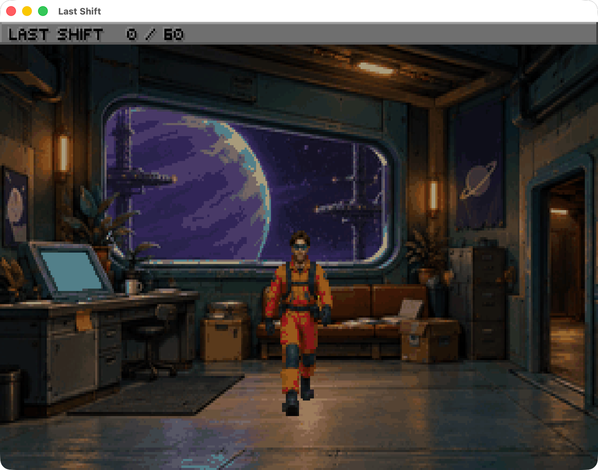

# Last Shift

This is a small test to see whether AI can create a game like the old Sierra adventures. I used Codex to build a three-screen sci-fi point-and-click game, including the game logic, generated artwork, animations and sound. The SIESTA intro is a parody of the old Sierra studio presentation.

There are three inventory items, a repair-and-escape puzzle, two animated ways to die, and a 60-point ending. A fairly small station to get yourself killed on.

The game uses **SCI 1.1**, with SCI Companion's existing template library for the underlying game framework. Codex generated the game-specific code and assets. ScummVM runs the native SCI resources. The source, asset prompts and build scripts are included so you can see what went into it.



## Play on this Mac

Install [ScummVM](https://www.scummvm.org/downloads/) in `/Applications/ScummVM.app`, then double-click **Play Last Shift.command**.

When applying a new build, quit the existing game and launch it again so ScummVM loads the new resources.

The launcher copies the finished game from `dist/Last Shift` into a fixed build folder under `release`, creates its own configuration with relative paths, and stores saves in `saves`. Rebuilding the project leaves an open game’s resources intact. The game runs offline. A new session opens with an eight-second **SIESTA** studio parody, then starts in reception. Click or press any key to skip the logo. Restart after a death goes straight to reception.

On another computer, install [ScummVM](https://www.scummvm.org/downloads/), add the folder `dist/Last Shift`, and start it. SCI fan games inherit the template's internal game identifier, so ScummVM's detection dialog may call this **Space Quest V Demo**. Set the description to **Last Shift**. Everything needed by ScummVM is in that folder.

## Controls

- Move the mouse to the top edge to reveal the action bar: walking person, eye, hand, speech bubble, inventory, settings and help.
- Right-click cycles actions. Left-click performs the selected action.
- Use the **hand** to collect objects and operate machinery. Use the **eye** for descriptions and puzzle clues.
- Click visible doorways to walk to the threshold, cross horizontally, and walk into the adjoining room. This works in both directions. Control returns after the entrance animation.
- **W** selects walking, **L** looking, **U** the hand, and **T** talking.
- **I** or **Tab** opens inventory. Click an item; clicking another switches the selection while inventory stays open. Click **OK**, then click its target in the room. The pointer becomes the item.
- Click or press Return to dismiss text.
- **F5** saves; **F7** restores. ScummVM's global menu also provides save and restore.

## Graphics and sound

The game renders at 320×200, including the 10-pixel status bar, with a 256-colour palette. Room art occupies 320×190. ScummVM corrects the original VGA pixel aspect ratio; filtering is disabled for crisp pixels.

Three newly generated painted room backgrounds are reduced to a shared palette, with 64 colours reserved for the interface. The maintenance worker uses generated painted artwork, eight walking phases and eight SCI heading loops. A consistent 76-pixel base body fits a 68×80 cel. Native SCI perspective scaling changes his size from 90% at the back of the floor to 125% at the foreground. Diagonal travel uses the corresponding side profile. All three inventory icons use matching painted artwork.

Six original 11,025 Hz mono digital sounds provide the station hum, collection/repair chime, generator start, completion cue, electrical shock and power-cell blast. The startup adds a seventh sound: an original 22,050 Hz brass fanfare that slides downward and wheezes as the gold mountain falls asleep. Its source MIDI and rendered WAV are included. No SQ4 logo or music assets ship with the game. SCI 1.1 has one digital sample channel, so a sound effect stops the hum. There is no voice acting.

The SIESTA sequence uses six generated gold emblem poses and its own VGA palette. The seal stays in place while the mountain slumps, then a sleeping Z and **ADVENTURES AFTER LUNCH.** appear. The startup hides gameplay controls and restores the room palette, cursor, sound and controls on completion or skipping.

The powered generator has an exposed live coupling. Inspecting it is safe; using the hand after restoring power triggers a six-frame shock-and-collapse animation at the same perspective scale, followed by Restart and Restore buttons. The power-restoration message and look description warn of the danger. Using the wrench on the uncollected bench cell causes an explosion, damages the workshop, collapses the worker and leaves animated smoke rising while Restart/Restore remains open.

Wrench pickup walks to the chest, opens its lid, and reaches inside. Power-cell pickup walks to the bench, reaches, and removes the cell from the scene. Generator repairs and cell insertion use approach and working poses before awarding progress. Kiosk use approaches the counter before the clerk responds. Craft use walks up the ramp and sits visibly in the cabin before showing a response; a failed departure returns the character to the floor. A powered reactor pulses a small glow in its central socket and plays its startup sound. Only the near door jamb draws over the actor while he passes through the opening. Furniture constrains the walkable floor; scenery patches draw behind the actor. Door interaction verbs do not change rooms; only Walk crosses a doorway. Physical item use approaches its target before a response. Movement uses three-pixel increments at a two-tick delay and elapsed-time catch-up keeps movement independent of room update rate, and animation follows distance travelled.

Interactions with no outcome use dry humour rather than navigation tutorials. The controls popup has been removed from the introduction; controls remain documented above.

## Project files

- `dist/Last Shift/`: finished playable SCI resources and digital audio.
- `game/src/`: editable SCI Companion source and object files. Original game logic lives in `StationActions.sc`, `rm110.sc`, `rm111.sc`, `rm112.sc`, `Inventory.sc`, `Main.sc`, `SiestaIntro.sc` and `AboutCode.sc`.
- `assets/source/rooms.png`: full-size generated room contact sheet.
- `assets/source/worker-walk-v5.png`: current transparent painted character walk sheet.
- `assets/source/siesta-logo-poses.png`: six original gold studio-logo poses generated with built-in imagegen; the exact prompt is saved in `siesta-logo-prompts.txt`.
- `assets/source/siesta-fanfare.mid` and `siesta-fanfare.wav`: original startup music and rendered source audio.
- `assets/source/*prompts*.txt` and `generator-active-prompt.txt`: exact saved art prompts and generation provenance.
- `assets/converted/`: native-size backgrounds, worker and death sprite sheets and WAV versions of the sounds.
- `scripts/`: asset encoder, compiler setup, compilation, packaging and isolated runtime tests.
- `verification/`: screenshots, logs and playthrough results.

## Rebuild

The existing project is ready to compile. Docker/OrbStack hosts the Linux headless compiler; it is a build tool, not a runtime dependency.

```sh
./scripts/setup_compiler.sh
python3 scripts/compile_game.py
python3 scripts/package_game.py
```

To regenerate the native graphic/audio resources from the saved art, install Pillow and run `python3 scripts/build_assets.py` before packaging. The encoder does not call an image API. Edit the SCI files directly; no commercial Sierra IDE or original game installation is required.

To recompose the SIESTA sting, run `docker exec three-room-sci-builder python3 /work/scripts/build_siesta_audio.py`, then rebuild assets and package. This uses FluidSynth and the builder's installed General MIDI bank; the saved WAV lets ordinary asset rebuilds run without the synthesizer.

The compiler port is pinned to `katiahayati/lucasartsifier` commit `45068351290ffd90e74186c69322d200fa60cafd`; SCI Companion is pinned to `icefallgames/SCICompanion` commit `f1a603b48b1aa7abf94f78574a8f69a653e2ca62`.

## Validation

The game has been compiled and rendered in native macOS ScummVM. An isolated Linux ScummVM display is used for the mouse-driven playthrough, including inventory selection, failed puzzle actions, walking, room transitions and the ending. Save and restore were also checked by saving at 40 points, advancing to 50, and restoring to 40.

Run `python3 scripts/playthrough_test.py` against a freshly started game in the prepared isolated display. It checks the packaged game, verifies rendered room art and score glyphs, and writes `verification/playthrough-results.json`. See `verification/VALIDATION.md` for the final results.

## Credits

Original game, artwork adaptation, sprites and sounds created for this project. The backgrounds were generated with Codex's built-in OpenAI image tool using the bundled imagegen skill.

The supporting class library and interface resources come from Phil Fortier's [SCI Companion SCI 1.1 template](https://github.com/icefallgames/SCICompanion). The headless compiler port comes from [lucasartsifier](https://github.com/katiahayati/lucasartsifier). [ScummVM](https://www.scummvm.org/) supplies the modern interpreter. The original fanfare is rendered with FluidSynth and the TimGM6mb SoundFont. See [third-party notices](THIRD_PARTY_NOTICES.md) for attribution and component details.

## License

Last Shift's original contributions are [MIT licensed](LICENSE). The inherited SCI template code and resources, and third-party instrument samples, retain their own terms; see [THIRD_PARTY_NOTICES.md](THIRD_PARTY_NOTICES.md).

<details>
<summary>Walkthrough (spoilers)</summary>

1. Take the wrench from reception's yellow toolbox.
2. Enter the workshop and take the power cell from the right-hand bench.
3. Use the wrench on the generator, then use the power cell on it.
4. Return to reception and use the kiosk to obtain a transit card.
5. Enter the pod bay through the workshop's right exit.
6. Use the transit card on the launch console, then use the hand on the escape pod.

</details>
